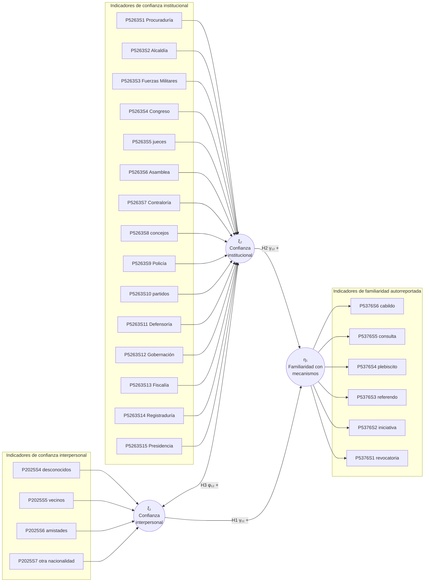

# Especificación teórica y estadística del modelo SEM

**Proyecto:** Taller 1 - ECP Colombia 2023  
**Estado:** especificación de referencia basada en la propuesta aprobada; no implica que el modelo haya quedado validado.  
**Unidad de análisis:** persona de 18 años o más encuestada en la ECP 2023.  
**Muestra usada en análisis anteriores:** 35.024 casos completos en los 25 indicadores.  
**Estimador previsto:** WLSMV para indicadores ordinales y binarios, con las limitaciones de caso completo y diseño muestral descritas al final.

## 1. Pregunta y marco conceptual

**Pregunta:** ¿Cómo se asocian la confianza interpersonal y la confianza en instituciones con la familiaridad autorreportada con mecanismos de participación ciudadana en personas encuestadas en Colombia en 2023?

La ECP mide tres dominios que conviene mantener conceptualmente diferenciados:

1. **Confianza interpersonal:** confianza declarada en grupos de relación distinta: personas desconocidas, vecinos, amistades y personas de otra nacionalidad. No se debe llamar estrictamente “confianza generalizada”: la batería combina confianza en personas desconocidas con confianza en vínculos cercanos (cuestionario ECP, pregunta 39). La literatura separa confianza generalizada, particularizada e institucional y advierte que sus indicadores no son intercambiables (Delhey y Newton, 2005).
2. **Confianza institucional:** evaluación de cuánta confianza inspiran 15 instituciones o actores públicos en una escala común de 1 (“no confía”) a 5 (“confía mucho”), con 99 = no sabe/no informa. El constructo se entiende como una evaluación actitudinal de las instituciones, no como desempeño institucional objetivo ni como confianza interpersonal (Levi y Stoker, 2000).
3. **Familiaridad autorreportada con mecanismos de participación:** la pregunta de la ECP solicita marcar cuáles mecanismos “conoce o de cuáles ha oído hablar” (revocatoria, iniciativa popular, referendo, plebiscito, consulta popular y cabildo abierto; cuestionario ECP, pregunta 5). Por ello, los seis indicadores miden reconocimiento declarado, no conocimiento factual comprobado, comprensión jurídica, uso ni participación efectiva. La literatura de conocimiento político distingue el recuerdo de información factual de otras dimensiones de involucramiento cívico (Delli Carpini y Keeter, 1996).

El capital social suele asociar redes, reciprocidad y confianza con cooperación cívica (Putnam, 1993), y la cultura cívica vincula orientaciones políticas y competencia ciudadana (Almond y Verba, 1963). Desde ese marco, la confianza interpersonal puede facilitar conversaciones e intercambio de información cívica. La confianza institucional puede acompañarse de familiaridad con canales formales porque las personas que perciben legitimidad o accesibilidad institucional tendrían más razones para atender cómo funcionan esos mecanismos. Sin embargo, la evidencia sobre consecuencias de la confianza política es heterogénea; una metaanálisis reciente encuentra asociaciones variables según el tipo de resultado y no justifica inferir causalidad (Devine, 2024). Además, la relación entre participación y confianza puede operar en ambas direcciones y por selección (van Ingen y Bekkers, 2015). Así, los signos siguientes son expectativas teóricas para una asociación transversal, no afirmaciones causales.

## 2. Constructos e indicadores

| Latente | Rol en el modelo de referencia | Indicadores observados | Escala y orientación |
|---|---|---|---|
| `ConfianzaInterpersonal` | Exógena, `ξ₁` | P2025S4 desconocidos; S5 vecinos; S6 amistades; S7 personas de otra nacionalidad | Ordinal 1-5; mayor valor = mayor confianza; 99 a NA |
| `ConfianzaInstitucional` | Exógena, `ξ₂` | P5263S1-S15: Procuraduría, Alcaldía, Fuerzas Militares, Congreso, jueces, Asamblea, Contraloría, concejos, Policía, partidos, Defensoría, Gobernación, Fiscalía, Registraduría, Presidencia | Ordinal 1-5; mayor valor = mayor confianza; 99 a NA; Asamblea y Gobernación no aplican en Bogotá |
| `ConocimientoMecanismos` | Endógena, `η₁` | P5376S1-S6 en el orden del cuestionario | Dicotómica recodificada: 1 = sí conoce/ha oído, 0 = no; mayor valor = mayor familiaridad |

El modelo mantiene las tres baterías aprobadas por el docente. Los diagnósticos previos apoyan explorar esta estructura, pero no autorizan a declarar validadas las mediciones: el CFA previo tuvo ajuste mixto y el análisis paralelo sugirió cinco factores, mientras el AFE teórico de tres factores fue interpretable. La confianza institucional en dos dimensiones queda como rival/sensibilidad separada, no como reemplazo aprobado.

## 3. Hipótesis y signos esperados

| Hipótesis | Parámetro | Enunciado | Signo esperado |
|---|---|---|---:|
| H1 | `γ₁₁` | A mayor confianza interpersonal, mayor familiaridad autorreportada con mecanismos de participación. La confianza entre grupos puede facilitar intercambio de información cívica y cooperación. | `+` |
| H2 | `γ₁₂` | A mayor confianza institucional, mayor familiaridad autorreportada con mecanismos formales. Se espera una asociación positiva por mayor orientación hacia canales institucionales, aunque esta es la hipótesis más incierta y puede depender del contexto. | `+` |
| H3 | `φ₁₂` | La confianza interpersonal y la institucional covarían positivamente porque pueden compartir experiencias y orientaciones cívicas; son dominios distintos, no sinónimos. | `+` |

La encuesta es transversal y observacional. Se reportarán coeficientes como **asociaciones ajustadas entre latentes**. H1 y H2 no se redactan como efectos causales ni como cambios producidos por la confianza.

## 4. Diagrama de caminos

Latentes en óvalos; indicadores observados en rectángulos. H1 y H2 son regresiones. H3 es una covarianza entre predictores.



Los errores de medición `δᵢ` y `εⱼ` y la perturbación estructural `ζ₁` se muestran en las ecuaciones y matrices, aunque se omiten en el diagrama para legibilidad. La sintaxis reproducible está en `07_especificacion_modelo.R`; la figura SVG está en `07_diagrama_modelo.svg`.

## 5. Ecuaciones del modelo

### Medición

Para los 19 indicadores de confianza `x` y seis de familiaridad `y`:

```text
x = Λx ξ + δ
y = Λy η + ε
```

Con `ξ = (ξ₁, ξ₂)'`, `η = η₁`, `x = (P2025S4,...,P2025S7,P5263S1,...,P5263S15)'` y `y = (P5376S1,...,P5376S6)'`.

### Estructural

```text
η = Bη + Γξ + ζ
B = [0]
Γ = [γ₁₁  γ₁₂]
```

Por tanto:

```text
ConocimientoMecanismos =
  γ₁₁ ConfianzaInterpersonal
+ γ₁₂ ConfianzaInstitucional
+ ζ₁
```

### Matrices de medición

`Λx` es de dimensión 19 × 2 y tiene estructura de bloques:

```text
Λx = [ λx11  0     ]       Λy = [ 1     ]
     [ λx12  0     ]             [ λy2  ]
     [ λx13  0     ]             [ λy3  ]
     [ λx14  0     ]             [ λy4  ]
     [ 0     λx21  ]             [ λy5  ]
     [  ...  ...   ]             [ λy6  ]
     [ 0     λx2,15]
```

El primer indicador marcador de cada latente fija su carga en 1: P2025S4 para `ξ₁`, P5263S1 para `ξ₂` y P5376S1 para `η₁`. Las otras 22 cargas son libres. Los ceros fuera de los bloques de `Λx` son cargas cruzadas fijadas a cero por la hipótesis de medición simple.

### Matrices de varianzas y covarianzas

```text
Φ = Var(ξ) = [ φ11  φ12 ]
             [ φ12  φ22 ]       φ11, φ12, φ22 libres

Ψ = Var(ζ) = [ ψ11 ]            ψ11 libre

Θδ = Var(δ) = diag(θδ1,...,θδ19)
Θε = Var(ε) = diag(θε1,...,θε6)
```

En `Θδ` y `Θε` se estiman libres las 25 varianzas diagonales; todas las covarianzas residuales entre indicadores distintos se fijan en cero. Esta es la especificación simple de referencia: no se liberan correlaciones residuales post hoc. `φ12` es la covarianza libre que corresponde a H3; su correlación latente debe calcularse para facilitar interpretación.

La covarianza implicada de los predictores es `Σxx = Λx Φ Λx' + Θδ`. Definiendo `C = (I-B)⁻¹ Γ`, la covarianza entre indicadores endógenos y exógenos es `Σyx = Λy C Φ Λx'`; la covarianza de indicadores endógenos es `Σyy = Λy [C Φ C' + (I-B)⁻¹ Ψ (I-B)⁻T] Λy' + Θε`. En este modelo `B=0`, entonces `C=Γ`.

## 6. Conteo de parámetros e identificación

### Conteo clásico de momentos de covarianza (regla solicitada en el taller)

Con `k = 25` indicadores, hay `k(k+1)/2 = 25×26/2 = 325` momentos distintos de covarianza. El conteo libre es:

| Componente | Parámetros libres |
|---|---:|
| Cargas: 22 libres; tres cargas marcadoras fijas en 1 | 22 |
| Varianzas residuales observadas: 25 diagonales de Θδ y Θε | 25 |
| Φ: varianzas de ξ₁ y ξ₂ y su covarianza φ₁₂ | 3 |
| Γ: dos regresiones estructurales | 2 |
| Ψ: varianza residual de η₁ | 1 |
| **Total t** | **53** |

Así, `t = 53 ≤ 325` y `gl = 325 − 53 = 272`. Los grados de libertad coinciden con los reportados por la estimación previa de lavaan del SEM de referencia (`df = 272`). La razón muestral es `35.024 / 53 ≈ 661` personas completas por parámetro, por encima de la orientación de 10 por parámetro del taller; esto no reemplaza un análisis de potencia ni corrige el diseño complejo.

### Correspondencia con indicadores ordinales en WLSMV

La cuenta anterior expresa el modelo LISREL de covarianzas y satisface literalmente la regla del enunciado. En la implementación ordinal, 19 ítems de cinco categorías aportan 4 umbrales cada uno y seis ítems dicotómicos aportan 1 umbral: **82 umbrales**. Junto con las 300 asociaciones entre pares, se estiman 382 estadísticas muestrales. Bajo la parametrización delta predeterminada de lavaan, las escalas de las respuestas latentes categóricas se identifican mediante restricciones y no se liberan como otras 25 varianzas continuas; los 22 parámetros de carga y los 6 estructurales más 82 umbrales suman 110 parámetros libres, dando de nuevo `382 − 110 = 272` grados de libertad. El resultado previo de lavaan (`df = 272`) verifica la cuenta ordinal efectiva para esta sintaxis.

### Argumento de identificación

- **Escala:** tres indicadores marcadores fijados en 1; las varianzas latentes correspondientes se estiman. En el modelo ordinal se aplican, además, las restricciones de escala de respuesta propias de la parametrización delta.
- **Regla de tres indicadores:** cada factor tiene 4, 15 o 6 indicadores (todos ≥ 3). Cada bloque tiene varios indicadores no marcadores para estimar sus cargas y errores.
- **Regla recursiva:** el único factor endógeno `η₁` recibe flechas de los dos factores exógenos; no hay bucles estructurales. `Φ` permite la covarianza entre exógenos y `Ψ` estima la perturbación de `η₁`.
- **Regla de orden:** se cumple holgadamente en la formulación de covarianzas, con 325 momentos y 53 parámetros libres. La regla es necesaria pero no suficiente; la identificación local y la solución admisible también dependen del rango de las restricciones y de los datos.
- **Comprobación empírica:** la sintaxis de referencia convergió en la ejecución anterior y lavaan reportó `df = 272`. Convergencia no equivale a validez del modelo ni a buena especificación sustantiva.

## 7. Modelo rival: dirección inversa

Un rival plausible invierte la dirección estructural: la familiaridad con los mecanismos se ubica como predictor de las dos confianzas. Personas que reconocen canales formales pueden estar más interesadas en la vida pública o más expuestas a interacciones con instituciones. El modelo conserva exactamente las mismas mediciones:

```text
ξ₁ = α₁η₁ + ζ₁
ξ₂ = α₂η₁ + ζ₂
Cov(ζ₁, ζ₂) = ψ₁₂
```

El rival estima seis parámetros estructurales: Var(η₁), dos regresiones α, dos varianzas de perturbación de confianza y una covarianza entre esas perturbaciones. Tiene 22 cargas y los mismos umbrales; bajo la parametrización ordinal suma los mismos 110 parámetros libres y 272 grados de libertad.

### Equivalencia observacional

Con las mismas mediciones, las dos estructuras son distintas ordenaciones de una matriz de covarianza libre de tres latentes. El modelo de referencia descompone esa matriz en covarianzas de predictores, regresiones hacia η₁ y una varianza residual; el rival la descompone en varianza de η₁, regresiones hacia las confianzas y covarianza residual. Bajo las covarianzas residuales libres indicadas, ambas pueden implicar la misma matriz de covarianza y, por tanto, el mismo ajuste global. Esta es una forma de equivalencia de modelos en SEM (MacCallum et al., 1993). **No se escogerá la dirección por CFI, RMSEA o chi-cuadrado**; para ello se necesitaría temporalidad, intervención, instrumento válido o una teoría de orden causal defendible. Los signos de las rutas del rival quedan abiertos.

## 8. Sintaxis R/lavaan reproducible

El archivo `07_especificacion_modelo.R` define la sintaxis etiquetada de referencia y del rival, reporta el conteo de parámetros y escribe ambas sintaxis a `salidas/`. La forma de llamada para la referencia es:

```r
fit_referencia <- lavaan::sem(
  modelo_referencia,
  data = analisis,
  ordered = items_modelo,
  estimator = "WLSMV",
  parameterization = "delta",
  missing = "listwise"
)
```

El estimador es coherente con las variables ordinales/binarias y el ajuste se debe interpretar usando índices robustos y residuos, no solo significación de chi-cuadrado. La recomendación de WLSMV para categorías ordinales frente a ML depende del número de categorías y distribución (Li, 2016). No se reestima automáticamente el modelo en esta actividad: aquí se completa la propuesta previa a la siguiente fase, de acuerdo con el flujo de dos pasos de Anderson y Gerbing (1988).

## 9. Limitaciones y decisiones antes de Fase 2

1. El resultado endógeno es familiaridad autorreportada, no conocimiento factual ni participación real.
2. La confianza interpersonal combina objetos cercanos y generalizados; el CFA unidimensional anterior mostró ajuste débil. Se retiene como modelo aprobado de referencia, pero su interpretación y validez requieren discusión con el docente.
3. La dimensión institucional es amplia; los CFA previos y la alternativa de dos factores mostraron desajuste y correlación muy alta entre factores alternativos. La alternativa de dos dimensiones queda exploratoria.
4. El modelo no incluye covariables como educación, edad, sexo o ruralidad. Pueden confundir las asociaciones; añadirlas debe justificarse teóricamente y con las variables disponibles.
5. El modelo analítico previo usó casos completos (75,5% de la intersección) y no incorporó ponderadores, estratos ni conglomerados del diseño DANE. En Fase 2 deben investigarse su disponibilidad y el tratamiento de faltantes estructurales de Asamblea/Gobernación.
6. El diseño transversal no identifica dirección causal. Se deben reportar asociaciones, no impactos.

## Referencias

- Almond, G. A., y Verba, S. (1963). *The Civic Culture: Political Attitudes and Democracy in Five Nations*. Princeton University Press.
- Anderson, J. C., y Gerbing, D. W. (1988). Structural equation modeling in practice: A review and recommended two-step approach. *Psychological Bulletin, 103*(3), 411-423. https://doi.org/10.1037/0033-2909.103.3.411
- Bollen, K. A. (1989). *Structural Equations with Latent Variables*. Wiley.
- DANE. (s. f.). *Encuesta de Cultura Política (ECP) 2023: formulario*. Archivo local del proyecto, capítulo E pregunta 5 y capítulo G pregunta 17. Portal ANDA: https://microdatos.dane.gov.co/index.php/catalog/822
- Delhey, J., y Newton, K. (2005). Predicting cross-national levels of social trust: Global pattern or Nordic exceptionalism? *European Sociological Review, 21*(4), 311-327. https://doi.org/10.1093/esr/jci022
- Delli Carpini, M. X., y Keeter, S. (1996). *What Americans Know About Politics and Why It Matters*. Yale University Press.
- Devine, D. (2024). Does political trust matter? A meta-analysis on the consequences of trust. *Political Behavior, 46*, 2241-2262. https://doi.org/10.1007/s11109-024-09916-y
- Li, C.-H. (2016). Confirmatory factor analysis with ordinal data: Comparing robust maximum likelihood and diagonally weighted least squares. *Behavior Research Methods, 48*(3), 936-949. https://doi.org/10.3758/s13428-015-0619-7
- Levi, M., y Stoker, L. (2000). Political trust and trustworthiness. *Annual Review of Political Science, 3*, 475-507. https://doi.org/10.1146/annurev.polisci.3.1.475
- MacCallum, R. C., Wegener, D. T., Uchino, B. N., y Fabrigar, L. R. (1993). The problem of equivalent models in applications of covariance structure analysis. *Psychological Bulletin, 114*(1), 185-199. https://doi.org/10.1037/0033-2909.114.1.185
- Putnam, R. D. (1993). *Making Democracy Work: Civic Traditions in Modern Italy*. Princeton University Press.
- Rosseel, Y. (2012). lavaan: An R package for structural equation modeling. *Journal of Statistical Software, 48*(2), 1-36. https://doi.org/10.18637/jss.v048.i02
- van Ingen, E., y Bekkers, R. (2015). Generalized trust through civic engagement? Evidence from five national panel studies. *Political Psychology, 36*(3), 277-294. https://doi.org/10.1111/pops.12105

